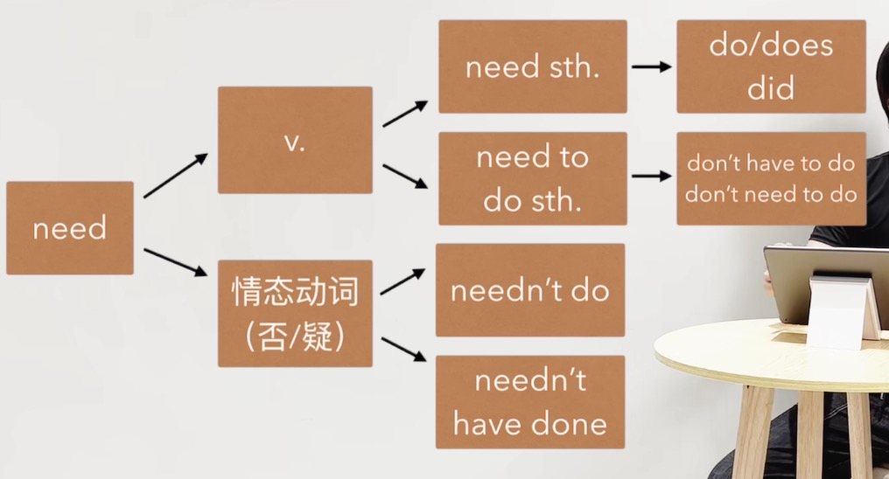

**完整的句子**

肯定句、否定句、一般疑问句、特殊疑问句、感叹句 各种变

**on、in、at  + 时间**

on + 具体某一天

in + 年 / 季 / 月

at + 时间点 ( at 8 o'clock )

###### will do 与 shall do 用法 - shall 只能在 I / we 后面用

 

**单词造句**

​	v.+v.变化
​	四句型转换
​	方式/地点/时间
​	结合习惯用法
​	其他单词+词性
​	原文摘抄+变

**习惯用法造句**

**频率 adv. 的位置 always & usually & sometimes etc. 1. v.前 2. be 后**

**时态：**

**一般现在时**：陈述一个客观事实

**一般过去式**：

- 规则动词一般在词尾加 -ed，如 work - worked。
- 不规则动词有其特殊的过去式形式，如 go - went，see - saw。

**一般将来时**：

- will + 动词原形。
- be（am/is/are）+ 动词的 -ing 形式。
- be going to + 动词原形，强调打算、计划做某事或有迹象表明要发生某事。例如：It's going to rain. Look at the dark clouds.（看那些乌云，快要下雨了。）

**现在进行时**：be（am/is/are）+ 动词的 -ing 形式。

**过去进行时**：was/were + 动词的 -ing 形式。

**现在完成时**：have/has + 动词的过去分词。

**过去完成时**：had + 动词的过去分词。

**将来进行时**：will + be + 动词的 -ing 形式。

**将来完成时**：will + have + 动词的过去分词。

###### 语法：will have done

⽤法1: ⼀个动作持续或重复到将来 (have done的将来时) 

We will have taken five exams by next Friday

⽤法2: ⼀个动作截⽌到未来某个时间前完成 

Next year they will have been married for 25 years. 

**过去将来时**：

- would + 动词原形。
- was/were going to + 动词原形。例如：She was going to buy a new dress, but she changed her mind.（她本来打算买一条新裙子，但她改变主意了。）

###### 被动 = be + done

be表时态

done表被动

被动的时态

am/is/are + done - 一般现在时

was/were + done - 一般过去时

am/is/are + being + done - 现在进行时

has/have + been + done - 现在完成时

had been done - 过去完成时被动

###### If 引导的从句 -- 

###### 主将从现 、 主情从现、主祈从现（祈使句没有主语 例如：Don‘t eat it）

###### must 与 have to

表肯定 - 必须要做某事 （must主观意愿，have to 客观原因并有多种时态变化）

拓展口语常用 - have got to ( i've gotta go )

表推测 - 

​	must 表可能性很高，

​	一般现在时 must be

​	过去式常用 must have done

​	过去式被动 must have been done

​	现在进行时 must be doing.

​	过去进行时 must have been doing

​	否定

​	can't be

​	can't have done

​	can't be doing

​	have to - 有一种 “根据客观情况来推断，不得不认为是这样” 的感觉。

###### may & might

对现在不确信的推测

may/might (not) do

may/might (not) be adj.

may/might (not) be doing

对过去不确信的推测

may/might (not) have done

may/might (not) have been adj.

may/might (not) have been doing.

###### 情态动词被动

will/would be done
can/could be done
must be done
have to be done

当时一定是被...

must have done + be done
must have been done

v. + of/from/in/on... + doing sth.

###### 并列连词 conj.  连接主语时单数复数形式就近原则

1. and、but、or、so

2. both....and ( 既是A 也是 B)

   either...or ( 要么A or B )

   neither...nor ( 既不是a也不是b)

3. not only...but aslo ( as well ) - 不仅....而且

   I not only spoke English very carefully, but very clearly as weel.

###### 定语从句

who/whom/which/that/whose

###### done做定语

通常表被动一般/被动完成

偶尔表示主动完成

单词 done 放形容词前面，短语 done 放形容词后面

###### doing做定语

主动进行

The sinking ship ≈ The ship that is sinking.

The rising sun ≈ The sun that is rising.

the sleeping child  ≈ The child who is sleeping.

I like the girl dancing with that guy.

主动一般

###### 定语的位置

时间 主 谓 宾 副词 地点 时间

形容词放名词前

done / doing 表形容词 - 单词放名词前、短语放名词后

###### used to do.

含义：过去常发生 现在已经不发生了

否定：didn't use to do.

###### as...as

as adv. （第一个as表同等的 一样的）as conj. ( 像 )

例句：

The blue car is as clean as the red car.

That car is as expensive as this one.

###### 表否定 - not so...as == not as ... as

1. She is not so tall as her sister.
2. This book is not so interesting as that one.
3. He doesn't run so fast as his friend.

###### so & such ( 表强调 - 如此 )

so + adj. / adv.
such + ( adj. ) + n.

had done 

###### no sooner .... than

一 ... 就 .... ( 表事件一仅挨着事件二发生 事件一使用过去完成时态 )

( 主语 + had no sooner + done ) + ( than + 句子（did ) )

He had no sooner returned than he bought a house and settled down in the country.

###### hardly ... when

几乎 ... 就 ...

( 主语 + had hardly + done ) + ( when+ 句子（did ) )

He had hardly had time to settled down when he sold the house and left the country.

###### 虚拟语气

If + did / were.  ( did并非表示过去 )

1.if 从句中 v. 与现在事实相反

2.说话人认为，if从句中发生的概率非常低

主 + would / should / could / might + do.

###### need全部用法

###### be able to do.

be(am/is/are) able to do sth.

have/has been able to do.

will be able to do.

区分 could 和 was able to do. 

1. 都可表过去能够做到某事
2. was able to do 可表过去成功事件 - succeeded in doing sth.

​		例句：The fire spread quickly, but everybody was able to escape.

​					was able to escape ( 过去成功逃脱 )

###### 分词做状语 ( 简化状从 N2L49)

例句：

###### doing做状语

The baby opened his eyes. 
The baby began to cry. 
When the baby opened his eyes, he began to cry. 
(When) opening his eyes, the baby began to cry. 

L45: Sam Benton, the local butcher,had lost his wallet while taking his savings to the post office.

###### done做状语

The city was destroyed during the war. 

The city has now been rebuilt. 

Although the city was destroyed during the war, the city has now been rebuilt. 

Destroyed during the war, the city has now been rebuilt. 

###### having done (强调过去)

He had completed the book. He had a holiday. 

After he had completed the book, he had a holiday. 

(After) Having completed the book, he had a holiday. After completing the book, he had a holiday. 

###### not doing （否定）

I did not want to wake her. I left the house silently. 

Because I didn’t want to wake her, I left the house silently. 

Not wanting to wake her, I left the house silently.

###### 现在完成进行时

( has / have ) been doing sth.

###### would do VS used to do

异1: 过去状态(past state)只⽤ used to do

异2: used to do 暗含现在不发⽣了

异3: ⽤used to do ⽽⾮ would 谈论[经常]且[重要]的[习 惯⾏为]。

###### 据说 be said to do sth. = it is said that...

He is said to be the wisest man in the universe. Go, find him.

It is said that we humans use only tiny portion of our brains.

It is said that music ... is a bridge between earth and heaven.

###### 强调句 it is(was)+强调部分+that(who)+剩余部分

Helen bought the car from Tom.

It was Helen that bought the car from Tom.

It was the car that Helen bought from Tom.

It was Tom that Helen bought the car from.

No, It was Tom that bought the car from Helen.

No, it was two years ago that Helen bought the car from Tom.

###### 连词：the moment

Everything stops the moment she walks in the room.

I recognized her the moment I saw her.

I fell in love with you the moment I saw you.

The moment you tell anyone about it, your life is absolutely worthless.

You ask God for help, and I'll stop the moment he shows up.

I promise you faithfully I shall go the moment I have finished the biscuit.

I call you the moment I know anything.

If you'll have a seat, I'll let you know the moment it arrives.

I feel in love with him the moment I held him.

I regretted it the moment it happened. 

###### 时间状语从句 --- 主将从现

**If** it rains tomorrow, we shall stay at home.

**The moment** he arrives, I shall tell you know.

I shall wait here **until** he comes.

**As soon as** the rain stop, we shall go out.

He must finish the dinner **before** you leave the table.

We'll go into the living room **after** we finish dinner. 

I'll give him the message **when** he returns.

###### 过去完成进行时

have been doing... L52
will have been doing... L61
had been doing...

###### 方式状语从句

as: in the way or manner that 按照...⽅式 

like 

as if 

as though 

the way...

例句：

Jeremy was a little disappointed by this but he did **as** his daughter asked.

When in Roma, do **as** the Romans do.

We must do **as** the doctor tells us.

You will do **as** I say and ask no questions.

Please, let me do **as** the Egyptian suggests.

Now do **as** I told you.

I did **as** Dracula instructed. I wrote three letters.

She must have more certainty than I did **as** a child.

By day, the children did **as** they were told.

She said unless I did **as** they asked, they would kill Lucy.

If you value his life, I suggest everyone does **as** they're told.

Carter always does **as** he's told,He's a good boy.

###### 现在相反的虚拟语气

###### If + did / was / were, 主 + would / should / could / might + do

If I were you, I wouldn't do that.

If I knew them better, I might invite them to dinner.

It's cold. If I were you, I would put my coat on.

###### 过去相反的虚拟语气

###### If + had done, 主 + ( would / should / could / might ) have done

could have done = had been able to

Police: Why didn't you shout for help when you were robbed of your watch.

Man:   If I had opened my mouth, they would have found my four gold teeth.That would be much worse.

###### could have done = had been able to

###### If + could have done, 主语 + ( would / should / could / might ) have done

If you could have spoken to me the first time in the jungle, what would you have said?

If I could have stayed down there, I would have (  stayed down there  ) believe me.

You know, Jammy, If I could have done anything, I would have been a painter.

###### if 真实条件句 

If jack didn’t come to work yesterday, he was probably ill. 

If you didn’t study English at school, you won’t understand this book. 

###### suggest that +句子

suggest that...should do

He suggested that a double railway-tunnel should be built.

###### should do & ought to do 

###### 肯定 (表应该):  

Leo will be alone tonight.

We should invite Leo to our party.

We ought to invite Leo to our party. 

###### 否定 （不应该）

You shouldn’t believe him.

You ought not to get out of the house.

You oughtn’t to call him that. 

###### ⼀般疑问句: 提句首

Should I call her?

Ought we to go back, Captain?

###### 本应该做某事，但却没有

should have done 

ought to have done

▪You look tired. You should (ought to) go to bed now. 

▪You went to bed very late last night. You should (ought to) have gone to bed earlier. 

###### 安排别人做某事：安排别人为自己做某事，通常需要支付费用。

have something done...

get something done...

含义: cause something to be done by somebody else

###### 过去成功做成某事 

managed to do sth. = was able to do sth. 

##### 非限定性定语从句

用于解释，补充，说明

My mother, who is 50 this year, lives with me now.

Beijing, which is the capital of China, has developed into a big city.

Among them will be Debble's mother, who swam the Channel herself.

##### which

只能放句尾

##### as

1.指代整个完整句子

2.位置灵活，前中后

As I soon learnt, he was English himself.

As they soon learnt, disguises can sometimes be too perfect.

##### 部分倒装 ▪ only 在句⾸，主谓(可能)颠倒。 

▪Only on one occasion have I ever felt frightened. 

▪Only then did I understand what she meant. 

▪Only after her death was I able to do that.

##### ▪only 说明主语，主谓不倒装。

▪Only policemen can come in. 

▪Only my mother really understands me. 

| 特殊疑问词                                                   | 频率      |
| ------------------------------------------------------------ | --------- |
| What Why Where When What kind of How  | How often |

情态动词

Can
May

Maybe